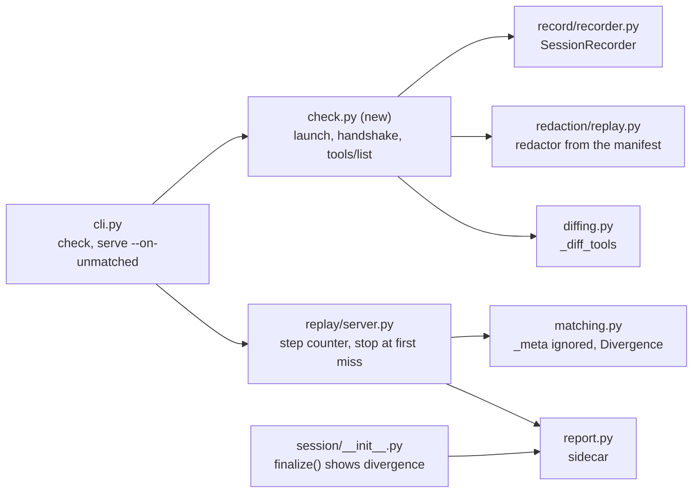

## Goal

Build Stage 1 of the business plan, the whole MVP: an upgrade tripwire for third-party MCP servers,
then frozen-world record and replay with a divergence report, for Python teams whose agents launch
stdio servers they do not own (see `BUSINESS_PLAN.md` §05, Stage 1).

How this plan was written: from §05 outward, as if no code existed, and only then checked against
v0.4.0 for what to reuse (the soft reboot, Entry 76; this plan, Entry 81). Scope comes from the
business plan. The repo only answers "how much of this is already built". Each In item below says
whether v0.4.0 already has it (keep), has something close (adapt) or lacks it (new).

Paths starting `.agents_workspace/` are in the private workspace, absent from a fresh clone (see
`CLAUDE.md`). Every other path is in the repo.

## Scope

**In:**

- **Upgrade tripwire, built first (new).** `mcp-cassette check` re-launches one third-party server
  and fails when it no longer starts, or when its tools, descriptions or input schemas differ from
  the committed cassette. It needs no model call and no test suite, and it reports "did not start"
  apart from "changed". `--record` writes the first baseline from the same handshake, and accepts
  an intended server change by rewriting a handshake-only baseline, so an outside team can adopt
  it in one CI line. A dummy key can be passed for servers that refuse to start without one.
- **Tripwire in the author's own CI (new),** straight after it is built rather than at the end.
- **Record on first run, replay offline after (keep).** The `mcp_cassette` pytest fixture and
  `once` mode, the recording proxy, the replay server and atomic saves are in v0.4.0.
- **Trace metadata never breaks a match (new).** Replay ignores `params._meta` when matching,
  because Langfuse and OpenTelemetry put a fresh trace ID there on every call (§06), which would
  make every traced agent miss on every call.
- **Divergence report (adapt).** At the first request the cassette has no answer for, replay
  reports the step, the recorded call and the new call side by side, and stops the run. It never
  falls through to a live server. v0.4.0 answers a miss with an error, continues, and lists the
  misses at exit with no recorded call to compare. That behaviour stays as the opt-in
  `on_unmatched="error"`.
- **CI forbids recording (keep).** `MCP_CASSETTE_MODE=none` fails on a missing cassette instead of
  recording, and `check --record` honours it too.
- **No secrets in the committed file (keep).** Key-glob redaction (`*token*`, `*secret*`,
  `authorization`) at capture time, on by default.
- **stdio transport (keep).** The only transport Stage 1 promises.
- **Readable, diffable file (adapt).** JSON indented by 2 with `format_version` is in v0.4.0. New:
  the README and OP-02 say the format is unstable (0.x) until 3 outside repos use it, the guard
  §12.01.01 puts on this one-way door. v0.4.0 says nothing about it.
- **Failure on cue (keep).** `FaultOverlay` and the `--faults` sidecar: timeout, error and dropped
  connection, without changing the recorded cassette.
- **Stage 1 front door (adapt).** The README and `docs/guide/` lead with the items above, in that
  order. Everything else v0.4.0 ships moves under one "beyond Stage 1, frozen" heading.
- **Proof of done (new).** Stage 1's done criterion from §05: the author's own suite in CI with the
  tripwire failing on a deliberately changed server, one failure test, one divergence report from
  a prompt change, and a cold reader reaching a green tripwire step in under 5 minutes.

**Out:**

- New work on the default-no items v0.4.0 already ships (Streamable HTTP, claims, PII packs,
  pacing, the async door, the Action and pre-commit hooks, lint and lint packs, `inspect --view`):
  frozen, not removed. The code and its tests stay green under the existing CI, they leave the
  README's lead, and they get no new features or hardening (`.claude/rules/decision-default-no-features.md`,
  `decision-stage-transport.md`). Removing them is left to the author (Open).
- `new_episodes` mode: frozen. It falls through to the real server on a miss, which §05 forbids
  for replay, but it is a recording aid, and plain replay never falls through. Removal is Open.
- Any change to the HTTP transport, including the divergence report and `stop`: Stage 2.
  `transports/http/server.py` is not changed, so HTTP replay keeps today's error-and-continue.
- `check` over Streamable HTTP: Stage 2, with the transport.
- A library door or pytest fixture for `check`: the tripwire is a CI step, so a CLI command is
  enough. Add one when an adopter asks.
- An opt-out for the `_meta` rule: no known server answers differently by trace metadata. Add a
  `MatchConfig` flag when one does.
- A packaged GitHub Action step for `check`: packaged CI is default-no, and the README's one
  `run:` line is the whole integration.
- Telling a failed `uvx`/`npx` download apart from a server crash by parsing their output:
  fragile across tool versions. "Did not start" plus the server's last stderr lines, where the
  download error appears, gives the same answer without the parsing.
- The Stage 2 server-upgrade check (old and new recording, trajectories compared): Stage 2.
- Model-side replay, live fall-through, nearest-match answers, schema contract checks: the §05
  "Never" list.
- The v0.5.0 release itself: `ceh-git-workflow:release` after this plan is built. The changelog
  lines this plan needs are written in the phases, under Unreleased.

## Design

**Reference implementation.** v0.4.0 at tag `v0.4.0`. Every keep item is reused as it is, and its
existing tests are its proof, so no phase rebuilds it. Each adapt or new item names the module it
grows from.

**Components touched.**

**Tripwire: `mcp-cassette check`.**

- Interface: `mcp-cassette check CASSETTE [--record] [--env KEY=VALUE]... [--timeout SECONDS] -- COMMAND [ARG...]`.
  The server command comes from the CLI, one CI line per server, so the cassette format does not
  change and no local path or command line is committed. `--env` is repeatable and adds to the
  inherited environment, for dummy keys. `--timeout` covers the whole run, launch to the last
  `tools/list` page, and defaults to 120 seconds, because a first `uvx` or `npx` run downloads the
  package inside it.
- `--record` stays a flag rather than a mode word, so a CI job that forgot `MCP_CASSETTE_MODE=none`
  still cannot write its own baseline and pass. The refusal goes through `resolve_mode()`
  (`session/__init__.py`): when it resolves to `none`, `--record` exits `2`.
- `--record` on an existing file: the file is overwritten only when its client requests are just
  `initialize` and `tools/list` (a handshake-only baseline), which is how a maintainer accepts an
  intended server change. On any other cassette, such as a full fixture session, it exits `2` and
  says to re-record through the fixture with `MCP_CASSETTE_MODE=all`, so one file keeps both
  guarding and replaying the server.
- Module: `src/mcp_cassette/check.py`, one function `check_server(cassette_path, command, *, env,
  timeout, record) -> CheckResult` that the CLI calls, not exported in `__all__`.
- Client: launch `COMMAND` with `anyio.open_process`, as `record/proxy.py` does, resolving
  `COMMAND[0]` with `shutil.which` so `npx` resolves to `npx.cmd` on Windows. Send `initialize`
  with empty `capabilities`, the cassette's `protocol_version` (or, when `--record` writes a first
  baseline, a `DEFAULT_PROTOCOL_VERSION` constant in `check.py` set to the newest MCP spec version
  at build time; the server answers with the version it supports either way), and `clientInfo`
  `{"name": "mcp-cassette-check", "version": __version__}`. Then `notifications/initialized`, then
  `tools/list`, following `nextCursor` until it is absent. Forward the server's stderr to ours, as
  the pump does.
- Server-initiated traffic: a `ping` request gets an empty result, any other server request gets
  JSON-RPC error `-32601`, notifications are ignored, and a stdout line that is not JSON is skipped
  and kept for the "did not start" message. Without this, a server that waits on its own request
  would stall until the timeout and read as "did not start".
- Shutdown: close the server's stdin, wait 2 seconds, terminate, wait 2 seconds, kill. On Windows
  the kill uses `taskkill /PID <pid> /T /F`, because `npx.cmd` runs node under `cmd.exe` and
  killing only `cmd.exe` leaves node holding the pipes.
- Every line both ways goes through a `SessionRecorder`. Its redactor is built from the committed
  cassette's `RedactionManifest`, the way `redaction/replay.py` resolves packs for replay, so a
  baseline recorded with `--pii-pack` or `--no-default-redactions` never shows drift that is only
  redaction. With `--record` and no cassette, the defaults apply, as for any first recording.
  `--record` saves through the atomic save.
- Comparison: `_diff_tools` in `diffing.py` on the committed cassette and the fresh in-memory one
  (added, removed, description, input_schema). It is what `diff --tools-only` prints, so `check`
  and `diff` can never disagree, and it takes loaded cassettes where the public `diff_cassettes`
  takes paths. A fixture session works as the baseline: `latest_tools` merges every `tools/list`
  in it, the last copy of each tool name winning. A `server_info.version` change is printed as
  information, never a failure.
- Outcomes and exit codes: `0` unchanged (or baseline written with `--record`). `5` tools changed,
  the existing "differs" code, printing the same tool lines as `diff --tools-only`. `7` (new)
  server did not start: it exited, closed stdout or did not answer `initialize` or `tools/list`
  within `--timeout`; the message gives which step, the exit code if any, and the last 20 lines of
  its stderr. `2` usage or load: no cassette and no `--record`; `--record` refused by mode `none`
  or by a non-handshake cassette; a baseline with no `tools/list` result; a baseline whose
  `transport` is not `stdio`. `130` interrupt.
- Exit code `7` joins the contract in `CLAUDE.md` and `docs/guide/operations/OP-04-cli-reference.md`.

**`_meta` ignored when matching.** `Matcher._canonical_key` always drops `/params/_meta` before
the user's `ignore_params`, so a caller passing their own list cannot lose it. Recorded keys and
incoming keys go through the same function, so cassettes recorded by v0.4.0 match unchanged.

**Divergence report.**

- `matching.py` gains a `Divergence` model, not exported in `__all__`: `step` (1-based count of
  client requests in this replay session, `initialize` included), `method`, `new_call`,
  `recorded_call` (or `None` when the recording is used up), and `reason` (`no-match` or
  `no-response`). Both calls are the request `params` canonicalized the same way as the match
  key (`_meta` and `ignore_params` dropped, redaction re-applied to the incoming one), so the diff
  shows only what made the match fail.
- The step counter lives in `ReplayServer`, which passes it in when it builds the `Divergence`,
  because `initialize` bypasses the matcher (`replay/server.py`).
- "Expected here": under `strict`, the next unconsumed exchange. Under `per_method` and `none`, the
  first unconsumed exchange with the same `method`, else the next unconsumed exchange of any
  method. Under `none` nothing is ever consumed, so `recorded_call` is never `None` there.
- Rendering: one block on stderr, `step N: <method>`, then a unified diff (`difflib`, as
  `diffing.py` already uses) of the two `params` as sorted, indented JSON, labelled `recorded` and
  `new`. A line diff stands in for two columns because terminals and CI logs wrap columns.
- `MatchConfig.on_unmatched` becomes `Literal["stop", "error"]`, default `"stop"`. `"stop"`:
  answer the request with the JSON-RPC error carrying the one-line summary, then leave the stdin
  loop the way the disconnect fault does (the `_Disconnect` break in `replay/server.py`, which
  cancels gated tasks), close stdout, write the report sidecar, print the block, and return `3`
  (the miss code is unchanged). No `os._exit`. `"error"`: today's behaviour, answer with the error
  and continue, with the block printed for the first miss and the one-line summaries for the rest
  at exit. Exposed as `serve --on-unmatched {stop,error}` and the marker's `on_unmatched=`, passed
  through the same path as `ordering`.
- The default change is breaking for 0.4.0 suites whose agents recover from a miss: a
  "Changed (breaking)" line under Unreleased in `CHANGELOG.md` names `--on-unmatched error` as the
  way back.
- The report sidecar gains `"divergence": {...} | null` beside `"misses"`. `CassetteSession.finalize()`
  puts the rendered block first in its failure message when present.

**Front door.** README order: what it is, install, the tripwire in one CI line, record and replay
in one test, the divergence report, failure on cue, CI settings, the format-stability line, then a
short "beyond Stage 1, frozen" list linking to the existing guide pages. `docs/guide/index.md`
gets the same two groups, and `getting-started.md` starts from the tripwire, because it is the
cold reader's path in phase 6. HT-09 is rewritten around `check`, keeping `lint` as a frozen side
note. Pages for frozen items stay as written. No page is deleted.

## Phases

### Phase 1: Upgrade tripwire

- **Builds:** the upgrade tripwire (In), per Design "Tripwire": `check.py`, the `check` subcommand,
  exit code `7`, an Unreleased "Added" line in `CHANGELOG.md`, and `examples/test_tripwire.py`
  against `examples/echo_server.py`. Tests use `tests/reference_server/` with a new
  `--tools-variant v2` flag (one changed description, one added input-schema property), plus a
  small stdlib-only stdio server in `tests/` that pages its `tools/list` with `nextCursor`, sends a
  `ping` and a `roots/list` before answering, and prints a non-JSON line first, because the
  FastMCP reference server cannot page.
- **Check:** `uv run pytest tests/integration/test_check.py tests/unit/test_check.py examples/test_tripwire.py -q`
  passes, covering: exit `0` unchanged; `0` with a full fixture session as the baseline; `5`
  changed, seeded from `examples/cassettes/tools.mcp.json` and `tools-v2.mcp.json`, with the tool
  lines printed; `0` across `nextCursor` pages and server-initiated requests; `--env` reaching the
  server; `7` for a server that exits and for one that times out, with its stderr tail shown; `2`
  for no cassette, for `--record` under `MCP_CASSETTE_MODE=none`, for `--record` over a fixture
  session, for a baseline with no `tools/list`, and for an HTTP cassette; `--record` overwriting a
  handshake-only baseline; a baseline recorded with `--no-default-redactions` showing no drift.
  Then `uv run ruff check . && uv run mypy src` pass, and
  `uv run coverage run -m pytest -q && uv run coverage combine && uv run coverage report` holds
  `fail_under = 99`.
- **Status:** todo

### Phase 2: Tripwire in the author's own CI

- **Builds:** the tripwire in the author's own CI (In): one `check` step per third-party server in
  the author's agent suite, installed from this branch by git URL until v0.5.0 is released.
- **Check:** manual, because the suite lives outside this repo: its CI run with the `check` steps
  is green, and the run's link goes into the phase's Status.
- **Status:** todo

### Phase 3: Ignore trace metadata when matching

- **Builds:** trace metadata never breaks a match (In), per Design "`_meta` ignored".
- **Check:** `uv run pytest tests/unit/test_matching.py -q` passes, including a new test where a
  recorded `tools/call` and an incoming one differ only in `params._meta.traceparent` and match,
  and one where the caller's own `ignore_params` list still drops `_meta`.
- **Status:** todo

### Phase 4: Divergence report

- **Builds:** the divergence report (In), per Design "Divergence report": the `Divergence` model,
  the step counter, `on_unmatched` stop and error, `serve --on-unmatched`, the marker option, the
  sidecar field, the `finalize()` message, the breaking-change line in `CHANGELOG.md`, and the
  default assertion in `tests/unit/test_cassette_schema.py` moved to `"stop"`. Plus
  `examples/test_divergence.py`, which replays a cassette with a request whose arguments changed,
  as a prompt change would make, and asserts the block.
- **Check:** `uv run pytest tests/unit/test_matching.py tests/unit/test_cassette_schema.py tests/integration/test_replay.py tests/system examples/test_divergence.py -q`
  passes, covering: stop at the first miss with exit `3` and the block naming step, recorded and
  new call; a miss after the recording is used up, under `per_method` (`recorded_call` is `None`);
  a matched request with no recorded response (`no-response`); `error` mode answering a later
  matched request after a miss; HTTP replay still answering a later matched request after a miss;
  a recorded and new call differing only in `_meta` and one other field, where the diff shows only
  the other field; and the fixture failure message leading with the block. Then
  `uv run ruff check . && uv run mypy src` pass, and the coverage command from phase 1 holds
  `fail_under = 99`.
- **Status:** todo

### Phase 5: Stage 1 front door

- **Builds:** the Stage 1 front door (In), per Design "Front door", and the format-stability line
  (In, "Readable, diffable file"): README, `docs/guide/index.md`, `getting-started.md`, HT-09,
  OP-02 (the `on_unmatched` row, which says "always an error" today, and the stability line),
  OP-03 (the tripwire as a CI step), OP-04 (`check`, `--on-unmatched`, exit `7`), OP-05 (reading a
  divergence report), and the exit-code and module lines in `CLAUDE.md`.
- **Check:** `grep -n "^## " README.md` lists the tripwire, record and replay, divergence and
  failure-on-cue sections before the frozen section; `grep -n "unstable" README.md docs/guide/operations/OP-02-configure.md`
  finds the stability line in both; `uv run pytest examples/ -q` passes. By hand, because no
  link checker or doc-command runner is installed: every command quoted in the touched pages is
  run once and gives the output the page shows, and every relative link opens.
- **Status:** todo

### Phase 6: Prove Stage 1 done

- **Builds:** proof of done (In). Run the §05 done criterion and write it up with
  `ceh-testing:write-evidence-report` in `.agents_workspace/product/EVIDENCE.md`, which is private
  because it links to the author's suite.
- **Check:** manual, because two parts run outside this repo. (1) The author's own agent suite
  runs in its CI with `MCP_CASSETTE_MODE=none`, has one failing-on-cue test and one divergence
  report from a prompt change, and its tripwire step goes red after the server is pinned to a
  changed version and green when reverted, each run linked in `EVIDENCE.md`. (2)
  `ceh-usability-audit:simulate-newcomer-first-run` with the goal "green tripwire step from a
  fresh install", where at least 2 of 3 personas finish without a stall and the walk takes under 5
  minutes by its own count.
- **Status:** todo

## Open

- Settled by the author on 2026-10-28, no longer open: the default-no items and `new_episodes`
  are frozen, not removed (Out); `check` takes the server command on the CLI after `--` (Design
  "Tripwire"); a miss stops the run by default, with `error` as the opt-in (Design "Divergence
  report"). A third mode that reports a miss without failing the test stays unplanned until the
  user asks for it.
- Where the author's own agent suite lives, for phases 2 and 6: assumed a separate repo the author
  points to when phase 2 starts. Phase 1 does not need it.
- Settled by the author on 2026-10-28: this plan and its review live in the repo's `product/`,
  with business material (budgets, dates, interviews) kept in `.agents_workspace/`, and the plan
  carries no hour estimates; the private hours log records actual time.

## Record

- 2026-10-28 Planned: status ready
- 2026-10-28 Reviewed: Revise first, 2 blocking (check --record on an existing cassette undefined and can clobber a fixture session; format-unstable label marked keep but absent and unbuilt)
- 2026-10-28 Design changed: was "`--record` writes the first baseline from the same handshake", now "`--record` writes the first baseline and rewrites only a handshake-only one, exiting 2 over a fixture session", because the review found an overwrite could clobber a replay cassette
- 2026-10-28 Design changed: was "Comparison: `diff_cassettes` on the committed cassette and the fresh in-memory one", now "Comparison: `_diff_tools` in `diffing.py`", because `diff_cassettes` takes paths, not loaded cassettes
- 2026-10-28 PR: #29 https://github.com/cheneeheng/mcp-cassette/pull/29
